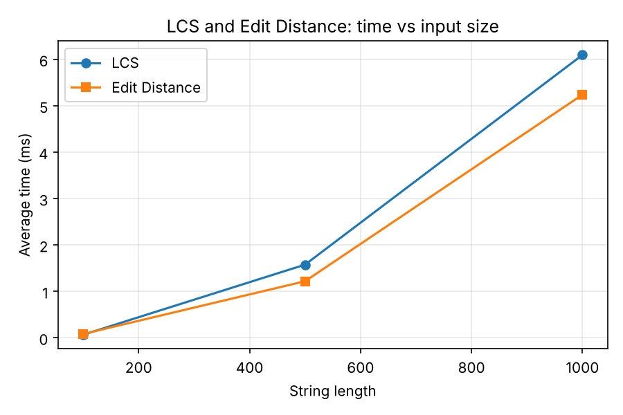
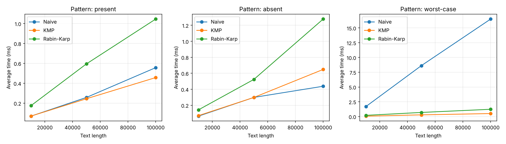
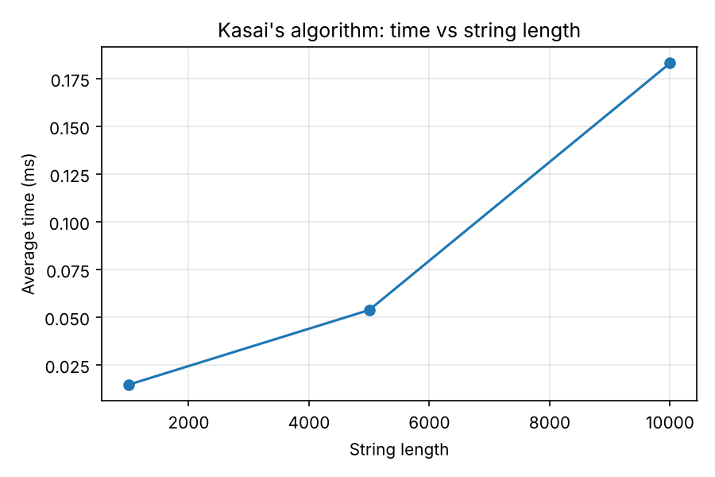

# Assignment 4 — Text Analysis: Dynamic Programming and String Algorithms

Java implementation and experimental comparison of dynamic-programming algorithms (LCS, Edit Distance), string-matching algorithms (Naive, KMP, Rabin–Karp) and Kasai's algorithm for the LCP array. All algorithms are implemented from scratch, without library replacements.

## 1. Problem description and algorithm overview

| Part | Algorithm | What it solves |
|---|---|---|
| A | Longest Common Subsequence (LCS) | Length of the longest subsequence shared by two strings |
| A | Edit Distance (Levenshtein) | Minimum number of insertions, deletions and substitutions to turn one string into another |
| B | Naive matching | Tries the pattern at every position of the text (baseline) |
| B | Knuth–Morris–Pratt (KMP) | Matching with a prefix (LPS) table, so text characters are never compared again after a mismatch |
| B | Rabin–Karp | Matching with a rolling hash; every hash hit is verified character by character |
| C | Kasai's algorithm | Builds the LCP array from a string and its suffix array in linear time |

### Why the recurrences are correct

**LCS.** `dp[i][j]` is the LCS length of the first `i` characters of `a` and the first `j` characters of `b`. Base case: if one of the prefixes is empty, the LCS is 0. If the last characters are equal, they can always be appended to an optimal LCS of the shorter prefixes, so `dp[i][j] = dp[i-1][j-1] + 1`. If they differ, at least one of them is not in the LCS, so the answer is the better of dropping the last character of `a` or of `b`: `max(dp[i-1][j], dp[i][j-1])`.

**Edit Distance.** `dp[i][j]` is the distance between the first `i` characters of `a` and the first `j` characters of `b`. Base cases: turning a prefix of length `i` into an empty string needs `i` deletions, and building a prefix of length `j` from an empty string needs `j` insertions. If the last characters are equal, nothing is needed for them: `dp[i-1][j-1]`. Otherwise the last operation is one of three: delete `a[i-1]` (`dp[i-1][j] + 1`), insert `b[j-1]` (`dp[i][j-1] + 1`) or substitute (`dp[i-1][j-1] + 1`). The minimum of the three is taken.

**KMP.** `lps[i]` is the length of the longest proper prefix of `pattern[0..i]` that is also a suffix of it. If a mismatch happens after `j` matched characters, the last `j` text characters are equal to `pattern[0..j-1]`, so the longest part that can still be reused is `lps[j-1]`. KMP continues from that position instead of restarting. The text index never moves backwards, so no text character is compared again after it was matched, and the search is O(n).

**Rabin–Karp.** The hash of a window is `s[0]·B^(m-1) + s[1]·B^(m-2) + … + s[m-1]` modulo `M`. Moving the window one position removes the contribution of the first character, multiplies the rest by `B` and adds the new character, which takes O(1). Different strings can have the same hash (a collision), so when two hashes are equal the algorithm compares the characters directly. The result is therefore always correct, and collisions only cost extra time.

**Kasai.** `lcp[i]` is the length of the longest common prefix of the suffixes `sa[i-1]` and `sa[i]` in sorted order. Suffixes are processed in text order. If suffix `i` has a common prefix of length `h` with its predecessor in sorted order, then suffix `i+1` has a common prefix of at least `h-1` with its own predecessor, because removing the first character of both suffixes keeps the rest equal. So `h` only decreases by 1 per step and is never recomputed from zero.

**What the LCP array represents.** After all suffixes of a string are sorted, `lcp[i]` tells how many leading characters suffix number `i` shares with suffix number `i-1`. It is used to find repeated substrings, the longest repeated substring (`max(lcp)`), the number of distinct substrings, and for fast pattern search with a suffix array.

## 2. Implementation decisions and assumptions

- **Language and build:** Java 25, Maven project (`pom.xml`), tests with JUnit 5.
- **Empty pattern:** `search` returns an **empty list** for all three matchers (no matches). This was chosen so that the three algorithms behave in the same way.
- **Pattern longer than the text:** returns an empty list.
- **Overlapping matches** are all reported. For example, `aba` in `abababa` gives `[0, 2, 4]`.
- **Common interface:** `StringMatcher` (`search`, `getComparisons`, `name`), so all three matchers are tested and measured by the same code.
- **Rabin–Karp hash:** base `131`, modulus `1,000,000,007`, `long` arithmetic. Every hash hit is verified character by character.
- **DP tables:** the full `(n+1) x (m+1)` table is used, as the assignment asks for a dynamic programming table.
- **Suffix array:** a simple builder that sorts all suffixes with `String.compareTo` is used only to prepare input for Kasai's algorithm. The assignment allows this, and it is not part of the timed region.
- **Operation counts:** the code counts character comparisons for Naive, KMP and Rabin–Karp. For KMP the count includes building the LPS table. For Rabin–Karp it counts only the verification comparisons after a hash hit; the hash arithmetic is not counted.
- **Alphabet:** all random strings use the alphabet `ACGT` (4 letters). With a small alphabet partial matches are more frequent, which makes the comparison of the algorithms more meaningful.

### Project structure

```
src/main/java/org/example/
  dp/        LCS.java, EditDistance.java
  matching/  StringMatcher.java, NaiveMatcher.java, KMPMatcher.java, RabinKarpMatcher.java
  suffix/    SuffixArray.java, Kasai.java
  bench/     Benchmark.java
src/test/java/org/example/
             DpTest.java, MatchingTest.java, KasaiTest.java
results/     dp_results.csv, matching_results.csv, kasai_results.csv, results.md
plots/       dp_time.png, matching_time.png, kasai_time.png
```

## 3. Complexity analysis

n = text length (or length of the first string), m = pattern length (or length of the second string).

| Algorithm | Main operation / recurrence | Best case time | Worst case time | Auxiliary space | Justification |
|---|---|---|---|---|---|
| LCS | `dp[i][j] = dp[i-1][j-1] + 1` if equal, else `max(dp[i-1][j], dp[i][j-1])` | O(n·m) | O(n·m) | O(n·m) | Every cell of the table is computed once in O(1), and the table has (n+1)(m+1) cells. |
| Edit Distance | `dp[i][j] = dp[i-1][j-1]` if equal, else `1 + min(delete, insert, substitute)` | O(n·m) | O(n·m) | O(n·m) | Same table-filling argument as LCS. |
| Naive | Compare the pattern with the text at every shift | O(n) (a mismatch on the first character at every shift) | O(n·m) (for example text `AAAA…A`, pattern `AAA…AC`) | O(1) | There are n−m+1 shifts, and each costs up to m comparisons. |
| KMP | Build the LPS table; on a mismatch `j = lps[j-1]` | O(n + m) | O(n + m) | O(m) | Building the LPS table is O(m). In the search `i` never decreases, and `j` can decrease only as many times as it was increased, so the search makes at most 2n steps. |
| Rabin–Karp | Rolling hash: remove the first character, multiply by `B`, add the new character; verify when hashes are equal | O(n + m) expected | O(n·m) | O(1) | The hash update is O(1). A verification (O(m)) happens only when the hashes are equal. With a good hash, false hits are rare, so the expected time is O(n + m). Worst case: many collisions, or many real matches (for example `AAAA…` with pattern `AAA…`), where each hit costs O(m). |
| Kasai (LCP) | Reuse `h` from the previous suffix: `h` decreases by at most 1 per step | O(n) | O(n) | O(n) | `h` increases at most 2n times in total and decreases at most n times, so the inner `while` loop does O(n) work overall. The extra space is the `rank` and `lcp` arrays. |

**Theory vs measurement.** The table shows *theoretical* growth rates (Big-O). The measured times in section 6 are *real execution times* on one machine. They include constant factors, JIT compilation, memory caches and garbage collection. Big-O predicts how time *grows* with the input size, not the exact number of milliseconds. For Rabin–Karp the expected and worst-case bounds are different: the expected bound assumes that hash collisions are rare, while the worst case assumes that almost every window needs a full verification.

## 4. Testing strategy and results

Tests are written with JUnit 5 and are in `src/test/java/org/example/`. In `MatchingTest` every test runs **all three** matchers (Naive, KMP, Rabin–Karp) and requires each of them to return exactly the expected list of indices, so the three algorithms are also checked against each other.

| Test class | Cases covered |
|---|---|
| `DpTest` (LCS) | identical strings, completely different strings, empty string (one and both), classic example `ABCBDAB` / `BDCABA` = 4 |
| `DpTest` (Edit Distance) | identical strings, one string empty (both directions), substitution (`cat` → `cut`), insertion (`cat` → `cart`), deletion (`cart` → `cat`), `kitten` → `sitting` = 3 |
| `MatchingTest` | pattern at the beginning, in the middle and at the end; multiple overlapping occurrences; pattern absent; pattern longer than the text; empty pattern; pattern equal to the text; a single repeated character |
| `KasaiTest` | `banana` with the manually verified suffix array `[5, 3, 1, 0, 4, 2]` and the expected LCP `[0, 1, 3, 0, 0, 2]`; the suffix array builder compared with the manual result |

**Manual check for `banana`.** The sorted suffixes are `a` (5), `ana` (3), `anana` (1), `banana` (0), `na` (4), `nana` (2). The common prefix with the previous suffix is: none → 0, `a`/`ana` → 1, `ana`/`anana` → 3, `anana`/`banana` → 0, `banana`/`na` → 0, `na`/`nana` → 2. So the LCP array is `[0, 1, 3, 0, 0, 2]`.

**Result:** 22 tests, 22 passed, 0 failed.

## 5. Experimental setup

- **Alphabet:** `ACGT`. **Random seed:** fixed (`42 + input size`), so every run generates the same inputs.
- **Input sizes:** LCS and Edit Distance — strings of length 100, 500 and 1,000. String matching — text length 10,000, 50,000 and 100,000. Kasai — string length 1,000, 5,000 and 10,000.
- **Same inputs:** LCS and Edit Distance use the same two strings. Naive, KMP and Rabin–Karp use the same text and the same pattern in each comparison.
- **Patterns (length 20):** *present* — a substring taken from the middle of the text; *absent* — a random pattern that was checked not to occur in the text.
- **Extra adversarial case (pattern length 100):** text `AAAA…A` and pattern `AAA…AC`. This is the known worst case for the Naive algorithm and does not occur in random texts.
- **Timing:** `System.nanoTime()`. Each measurement makes 5 untimed warm-up runs (so that the JIT compiler can optimize the code) and then **5 timed runs**; the **average** is reported. Input generation, suffix-array construction, console output and file writing are outside the timed regions.
- **Operation counts:** character comparisons for Naive, KMP and Rabin–Karp.
- **Environment:** Windows, Java 25, IntelliJ IDEA.
- **Plots:** created from the CSV files in `results/` with Python (matplotlib).

## 6. Experimental results

Alphabet: ACGT, seed: 42, runs per measurement: 5

### LCS and Edit Distance (average of 5 runs)

| Length | LCS time (ms) | Edit Distance time (ms) | LCS result | Edit Distance result |
|---|---|---|---|---|
| 100 | 0.066 | 0.083 | 61 | 56 |
| 500 | 1.577 | 1.219 | 320 | 262 |
| 1000 | 6.096 | 5.240 | 647 | 524 |

### String matching (average of 5 runs)

| Scenario | Text length | Algorithm | Time (ms) | Comparisons | Matches |
|---|---|---|---|---|---|
| present | 10000 | Naive | 0.0693 | 13416 | 1 |
| present | 10000 | KMP | 0.0699 | 12529 | 1 |
| present | 10000 | Rabin-Karp | 0.1746 | 20 | 1 |
| absent | 10000 | Naive | 0.0639 | 13308 | 0 |
| absent | 10000 | KMP | 0.0703 | 12455 | 0 |
| absent | 10000 | Rabin-Karp | 0.1426 | 0 | 0 |
| worst-case | 10000 | Naive | 1.6916 | 990100 | 0 |
| worst-case | 10000 | KMP | 0.0640 | 20098 | 0 |
| worst-case | 10000 | Rabin-Karp | 0.2002 | 0 | 0 |
| present | 50000 | Naive | 0.2573 | 66677 | 1 |
| present | 50000 | KMP | 0.2443 | 61831 | 1 |
| present | 50000 | Rabin-Karp | 0.5945 | 20 | 1 |
| absent | 50000 | Naive | 0.2984 | 66475 | 0 |
| absent | 50000 | KMP | 0.2978 | 62436 | 0 |
| absent | 50000 | Rabin-Karp | 0.5232 | 0 | 0 |
| worst-case | 50000 | Naive | 8.6174 | 4990100 | 0 |
| worst-case | 50000 | KMP | 0.2826 | 100098 | 0 |
| worst-case | 50000 | Rabin-Karp | 0.6909 | 0 | 0 |
| present | 100000 | Naive | 0.5567 | 132915 | 1 |
| present | 100000 | KMP | 0.4571 | 124696 | 1 |
| present | 100000 | Rabin-Karp | 1.0452 | 20 | 1 |
| absent | 100000 | Naive | 0.4377 | 133283 | 0 |
| absent | 100000 | KMP | 0.6479 | 125023 | 0 |
| absent | 100000 | Rabin-Karp | 1.2777 | 0 | 0 |
| worst-case | 100000 | Naive | 16.5052 | 9990100 | 0 |
| worst-case | 100000 | KMP | 0.5040 | 200098 | 0 |
| worst-case | 100000 | Rabin-Karp | 1.2276 | 0 | 0 |

### Kasai's algorithm (average of 5 runs)

| String length | Kasai time (ms) | Max LCP value |
|---|---|---|
| 1000 | 0.0146 | 9 |
| 5000 | 0.0538 | 12 |
| 10000 | 0.1831 | 13 |

### Plots

**Execution time vs input size for LCS and Edit Distance**



**Execution time vs text length for Naive, KMP and Rabin–Karp**



**Kasai's algorithm (extra plot)**



## 7. Discussion: theory vs experiment

- **LCS and Edit Distance** are both Θ(n·m), so doubling both lengths should multiply the time by about 4. From length 500 to 1,000 the measured time grew by 3.9x for LCS (1.58 → 6.10 ms) and by 4.3x for Edit Distance (1.22 → 5.24 ms), which matches the quadratic prediction. From 100 to 500 (5x longer, so about 25x more cells) the LCS time grew by about 24x. The two algorithms fill a table of the same size, so their times are close. The small differences between them (for example Edit Distance being slightly faster at lengths 500 and 1,000) are within measurement noise and do not contradict the theory.
- **String matching on random text.** On random text over a 4-letter alphabet a mismatch usually happens after 1–2 characters, so Naive works close to its best case. Its comparison count is about 1.3·n (13,416 comparisons for n = 10,000), which is similar to KMP (12,529). Because of this their times are almost the same. Rabin–Karp makes almost no character comparisons (20 for the present pattern, 0 for the absent one, so there were no hash collisions), but it does a multiplication and a modulo operation for every position. In practice it was about 2 times *slower* than the other two on these inputs. Fewer comparisons does not mean less time, because one comparison is much cheaper than one hash update.
- **Worst case for Naive.** On the adversarial input (`AAA…A` with pattern `AAA…AC`, m = 100) Naive makes about n·m comparisons (9,990,100 for n = 100,000), and its time was 16.5 ms. KMP made about 2n comparisons (200,098) and needed 0.5 ms; Rabin–Karp made no verification comparisons and needed 1.2 ms. This is the clearest confirmation of the theoretical O(n·m) vs O(n + m) difference: the Naive time is about 30 times larger than the KMP time at n = 100,000.
- **Kasai** grows approximately linearly with the string length: a 10 times longer string (1,000 → 10,000) took about 12 times more time (0.015 → 0.183 ms). The exact ratios between neighbouring sizes fluctuate because all times are fractions of a millisecond and the measurement noise is relatively large.
- **Limits of the measurements.** Many times are below one millisecond, so JIT compilation, garbage collection and the operating system can change a result by tens of percent between runs (for example, KMP was slower than Naive in one *absent* case at n = 100,000, although it makes fewer comparisons). Operation counts are exact and machine independent, so they are stronger evidence for the theory, while times show the real constant factors.

## 8. Conclusion

- **LCS vs Edit Distance:** the same Θ(n·m) time and space. Both could be reduced to O(min(n, m)) space if only the final value is needed, but then the actual subsequence or the sequence of edits cannot be reconstructed.
- **Naive:** the simplest algorithm, needs no extra memory and is fast on random text where mismatches come early, but it degrades to O(n·m) on repetitive input.
- **KMP:** guaranteed O(n + m) for any input, at the cost of O(m) extra memory for the LPS table and more complex code. It is the best choice when the worst-case behaviour matters.
- **Rabin–Karp:** expected O(n + m) with O(1) extra memory, and easy to extend to searching for many patterns at once. Its worst case is O(n·m), and its constant factor (hash arithmetic) is higher on simple inputs.
- **Kasai:** builds the LCP array in O(n) time and O(n) space once the suffix array exists, so in a suffix-array-based solution the cost is dominated by building the suffix array, not by the LCP array.

## How to compile and run

Requires JDK 25 (the version set in `pom.xml`) and Maven. In IntelliJ IDEA everything can be run from the editor.

**Tests**

```
mvn test
```

or in IntelliJ: right-click `src/test/java` → *Run 'All Tests'*.

**Experiments.** Run the `main` method of `org.example.bench.Benchmark` (IntelliJ: the green triangle next to `main`), or:

```
mvn compile
java -cp target/classes org.example.bench.Benchmark
```

The program writes `dp_results.csv`, `matching_results.csv`, `kasai_results.csv` and `results.md` into the `results/` folder in the project root. Run it from the project root so that the folder is created in the right place.
